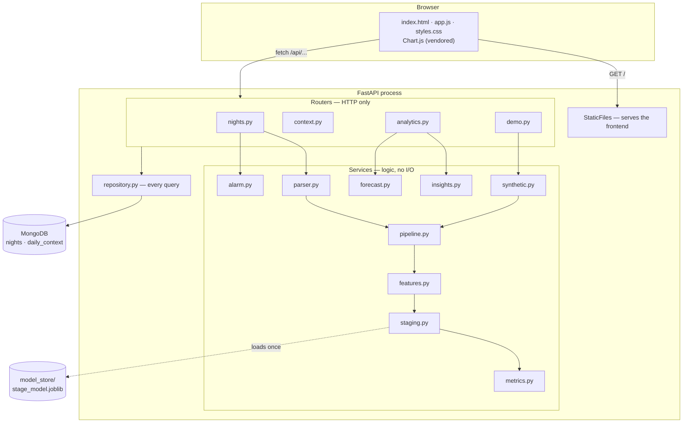
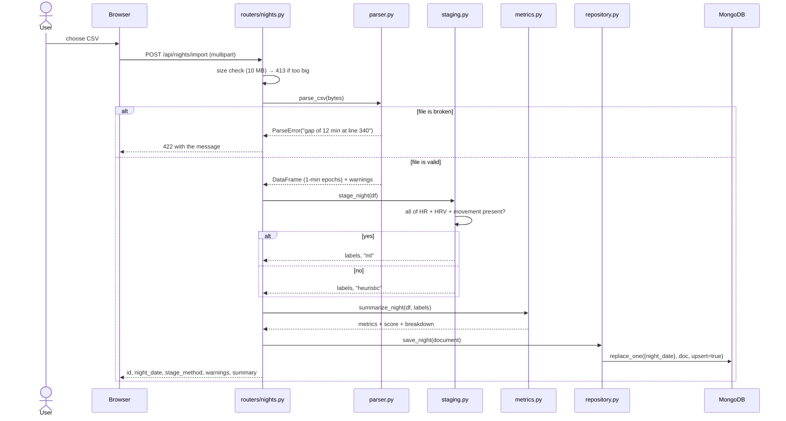
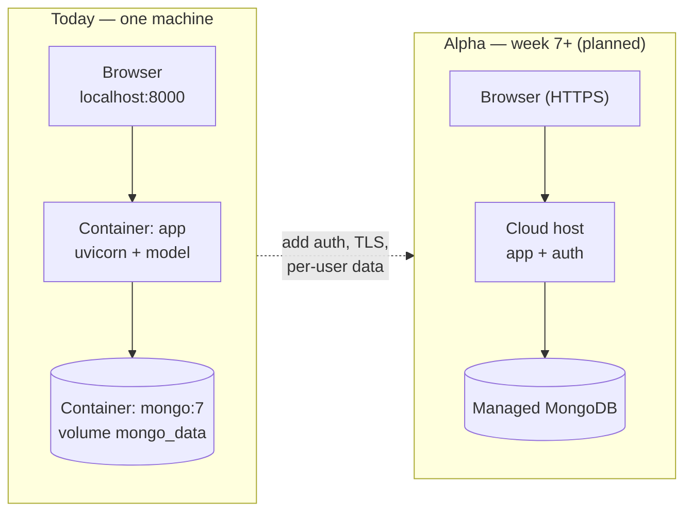

# Architecture

SleepInsight is a layered monolith: one FastAPI process that serves both the JSON API and the
static web interface, with MongoDB behind it. The layering is the only structural rule, and
it is enforced by a convention that is easy to check: **routers do HTTP, services do logic,
`repository.py` does the database, and nothing skips a layer.**

---

## Layers

Rules the diagram encodes:

- Arrows never go upward. A service never calls a router; `repository.py` never calls a
  service.
- Services never import `fastapi` and never open a database connection. That is why nine of
  the ten can be tested as plain functions.
- Only `repository.py` touches collections. Swapping MongoDB for something else would be one
  file plus `db.py`.
- `config.py` is the only module that reads environment variables.

---

## What happens when a night is imported

The upsert by `night_date` is why importing the same night twice replaces it instead of
creating a duplicate, and why the response carries `replaced_existing`.

---

## Deployment today, and next

The gap between the two boxes is the Alpha release in [ROADMAP.md](../../ROADMAP.md): without
authentication the app must not be exposed, because everything it stores is health data.

---

## Key design decisions, and the reason for each

| Decision | Reason | Cost |
|---|---|---|
| One process serves API and static files | Nothing to deploy twice, no CORS, no second origin to secure. At this size a separate frontend server would be ceremony. | The frontend cannot be put on a CDN without changing this. |
| One epoch = one minute, everywhere | Every module can assume the same grid: metrics count minutes, the model's windows are minutes, the alarm steps in minutes. | Sub-minute events (a 20-second arousal) are invisible. |
| Naive local timestamps | A night is a local thing: "I went to bed at 23:40" does not mean a UTC instant to the user. Offsets are dropped at the parser. | Travel across time zones mid-night is not handled. |
| `night_date = (bedtime − 12 h).date()` | A night that starts at 01:30 belongs to the previous evening; grouping by calendar date would split it. | One rule to remember when reading the code. |
| Epochs embedded in the night document | A night is always read whole. One query, no joins. | Documents are large; `MAX_EPOCHS` keeps them bounded. |
| Model loaded once into a module-level cache | Loading a RandomForest per request would dominate the response time. | Global state; `reset_model_cache()` exists for tests. |
| Model only used when its three signals are present | It was trained on seven features derived from HR, HRV and movement; feeding it imputed columns would produce confident nonsense. | Two staging paths to maintain and test. |
| `USE_MOCK_DB=1` runs without MongoDB | Tests need no infrastructure, and the project can be demonstrated anywhere. | A second database code path, though `mongomock` matches the PyMongo API. |

A critique of these decisions — including the ones that are wrong — is in
[critique.md](critique.md). The two decisions with the longest reasoning have their own
records in [adr/](adr/).
